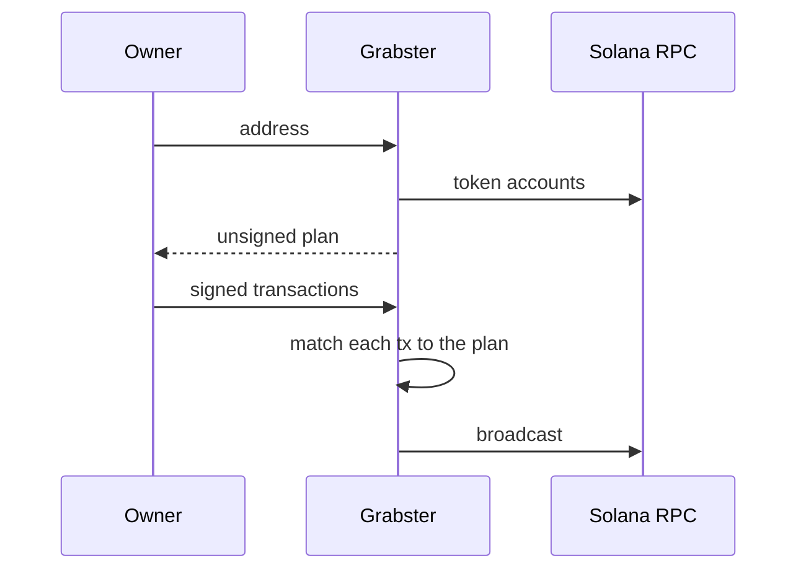
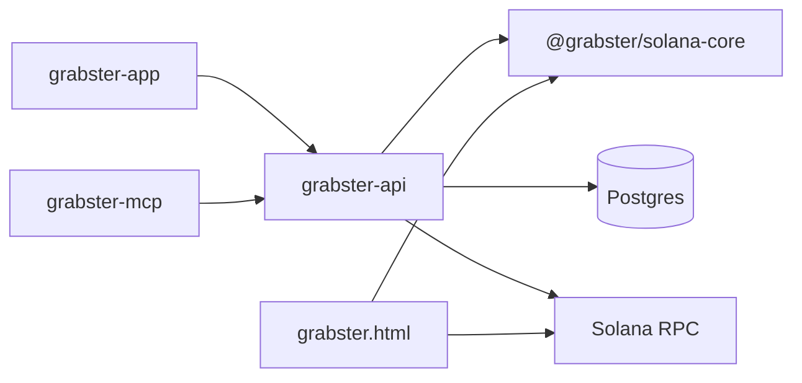

# Grabster

Reclaim SOL locked as rent in unused Solana token accounts. Grabster scans a wallet, builds the close transactions, and the owner signs them. The service fee is an instruction inside the transaction. The treasury co-signs only when it pays the network fee.

One planner, four ways to run it: the site, a partner API, an MCP server, and a single HTML file that never talks to Grabster.

## What gets reclaimed

Token accounts (SPL Token and Token-2022) are classified, then priced through Jupiter. Anything worth **$5 or more** stays. So do protected mints, frozen accounts, and NFTs in a verified collection.

| Class | What happens |
|---|---|
| Empty | Close the account. Rent returns to the owner. |
| Dust | Below $5. Burn it, or transfer it to Grabster and close. A sweep credits **50%** of the quoted value back in SOL. |
| NFT | Burn through Metaplex (token, metadata, edition) and take the rent. |
| Excess | `WithdrawExcessLamports` on Token-2022 accounts that hold more than the rent-exempt minimum. |

SOL can land on the same wallet, on another address, or on a Grabster balance. The fee is **1%** on a direct return and **0.5%** when the SOL is credited to that balance. The recipient is the treasury address written into the plan. The client cannot set it.

## Reclaim



1. **Scan.** Read SPL Token and Token-2022 accounts, classify them, attach Jupiter prices and Metaplex metadata.
2. **Plan.** Pack unsigned transactions (`CLOSE`, `BURN`, `SWEEP`, `NFT`, `REFUND`). The plan is stored with a TTL. Up to 25 closes per transaction, fewer when the instruction is heavier.
3. **Sign.** The owner signs in Phantom, Solflare, or another wallet. Grabster never receives a key or a seed. Requests that carry one are rejected.
4. **Check.** Each signed transaction is decoded and matched to the stored plan: allowed programs only, the expected closes, burns, sweeps and refunds, the fee destination, and the compute budget. Wallet assertion instructions are allowed. Anything else is dropped before broadcast.
5. **Send.** The treasury adds its signature only on transactions that already list it as a signer. Then the batch goes to RPC.

## Surfaces

| | |
|---|---|
| **Site** | Vue app. One wallet or a list (CSV). Sign-in is Sign-In with Solana, session in httpOnly cookies. |
| **Partner API** | `GET /v1/partner/scan/:address`, batch scan (25), `POST /v1/partner/plan`, `POST /v1/partner/submit`. Bearer key from the profile. OpenAPI at `/v1/partner/openapi.yaml`. |
| **MCP** | Same four tools over stdio (`grabster-mcp`) or `POST /mcp`: `scan_address`, `scan_batch`, `plan_reclaim`, `submit_signed`. |
| **Local file** | `grabster.html`. UI, scan, plan and signing run in the browser and talk only to the RPC in the form. The fee percent and treasury address are baked in at build time. |

## Repository

npm workspaces, Node **24.19.0**.

| Package | Role |
|---|---|
| `packages/solana-core` | Classify, pack transactions, inspect a signed transaction against its plan. Shared by the API, the site and the local file. |
| `grabster-api` | Express. Scan, plan, submit, SIWS sessions, balances, partner keys. Postgres tables are created on startup. |
| `grabster-app` | Vue 3, Vite, Pinia. Wallet connection through Reown AppKit. |
| `grabster-mcp` | Stdio MCP client over the partner API. |
| `grabster-local` | Vite single-file build, published as `grabster-app/public/grabster.html`. |



The API also prices dust through Jupiter and, when enabled, runs a background job that sells or burns tokens the treasury received from sweeps.

## Run

```bash
npm install
npm run dev          # API on :8787 and the site
npm run dev:local    # the single-file build
npm run start:mcp    # stdio MCP, needs GRABSTER_API_KEY
```

The API expects Postgres and a `.env` at the repo root. The values that have to be real:

| Variable | |
|---|---|
| `SOLANA_RPC_URL` | Mainnet RPC. |
| `TREASURY_ADDRESS`, `TREASURY_SECRET` | Fee recipient. The secret is used only to co-sign. |
| `DB_HOST`, `DB_PORT`, `DB_NAME`, `DB_USER`, `DB_PASSWORD` | Postgres. |
| `SECRET_ACCESS_SIGN_KEY`, `SECRET_REFRESH_SIGN_KEY` | Session token signing. |
| `JUPITER_API_KEY` | Token prices. Without it, dust stays unpriced. |
| `VITE_REOWN_PROJECT_ID` | Wallet connection in the site. Baked in at build time. |

`npm run check:inspect -w grabster-api` checks the transaction inspector. `npm run check:local-plan` checks the in-browser planner.

Production is Docker Compose: `make deploy`, or `make deploy-api` / `make deploy-app`.
